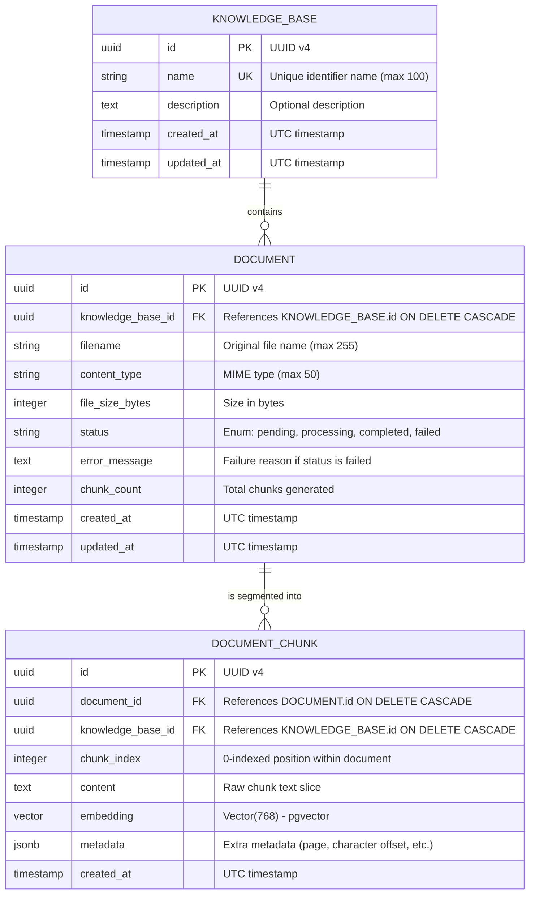

# Data Model: Knowledge Base Management & Document Ingestion

**Feature**: `001-knowledge-base-management`  
**Date**: 2026-11-13  
**Status**: Completed  

---

## 1. Diagrama Entidade-Relacionamento (ERD)



---

## 2. Especificação Detalhada das Tabelas

### 2.1 Tabela `knowledge_bases`
Representa um repositório isolado de tópicos/documentos.

| Coluna | Tipo SQL | Restrições | Descrição |
| :--- | :--- | :--- | :--- |
| `id` | `UUID` | Primary Key, Default: `gen_random_uuid()` | Identificador universal único. |
| `name` | `VARCHAR(100)` | NOT NULL, UNIQUE, Indexed | Nome amigável da base de conhecimento. |
| `description` | `TEXT` | NULLABLE | Descrição ou finalidade da base. |
| `created_at` | `TIMESTAMPTZ` | NOT NULL, Default: `NOW()` | Data de criação em UTC. |
| `updated_at` | `TIMESTAMPTZ` | NOT NULL, Default: `NOW()` | Data de última atualização em UTC. |

---

### 2.2 Tabela `documents`
Registra os arquivos enviados pelo usuário para uma base de conhecimento.

| Coluna | Tipo SQL | Restrições | Descrição |
| :--- | :--- | :--- | :--- |
| `id` | `UUID` | Primary Key, Default: `gen_random_uuid()` | Identificador único do documento. |
| `knowledge_base_id` | `UUID` | NOT NULL, FK $\rightarrow$ `knowledge_bases.id` `ON DELETE CASCADE` | Base à qual o documento pertence. |
| `filename` | `VARCHAR(255)` | NOT NULL | Nome original do arquivo sanitizado. |
| `content_type` | `VARCHAR(50)` | NOT NULL | MIME Type (`application/pdf`, `text/plain`, `text/markdown`). |
| `file_size_bytes` | `INTEGER` | NOT NULL | Tamanho do arquivo original em bytes. |
| `status` | `VARCHAR(20)` | NOT NULL, Default: `'pending'` | Estado: `'pending'`, `'processing'`, `'completed'`, `'failed'`. |
| `error_message` | `TEXT` | NULLABLE | Descrição detalhada do erro caso `status == 'failed'`. |
| `chunk_count` | `INTEGER` | NOT NULL, Default: `0` | Quantidade de chunks gerados e persistidos. |
| `created_at` | `TIMESTAMPTZ` | NOT NULL, Default: `NOW()` | Data de envio em UTC. |
| `updated_at` | `TIMESTAMPTZ` | NOT NULL, Default: `NOW()` | Data de modificação em UTC. |

---

### 2.3 Tabela `document_chunks`
Armazena os trechos de texto extraídos e seus respectivos vetores de embedding.

| Coluna | Tipo SQL | Restrições | Descrição |
| :--- | :--- | :--- | :--- |
| `id` | `UUID` | Primary Key, Default: `gen_random_uuid()` | Identificador único do chunk. |
| `document_id` | `UUID` | NOT NULL, FK $\rightarrow$ `documents.id` `ON DELETE CASCADE` | Documento de origem do chunk. |
| `knowledge_base_id` | `UUID` | NOT NULL, FK $\rightarrow$ `knowledge_bases.id` `ON DELETE CASCADE` | Desnormalização para otimização de busca vetorial por base. |
| `chunk_index` | `INTEGER` | NOT NULL | Posição sequencial do chunk no documento. |
| `content` | `TEXT` | NOT NULL | Texto bruto correspondente ao trecho. |
| `embedding` | `vector(768)` | NOT NULL | Vetor denso gerado pelo modelo `text-embedding-004`. |
| `metadata` | `JSONB` | NOT NULL, Default: `'{}'::jsonb` | Metadados adicionais (página, offset de início/fim, headers). |
| `created_at` | `TIMESTAMPTZ` | NOT NULL, Default: `NOW()` | Data de criação em UTC. |

---

## 3. Índices e Estratégia de Performance

1. **Índice Relacional Primário e Estrangeiro**:
   - `idx_documents_kb_id` em `documents(knowledge_base_id)`
   - `idx_chunks_doc_id` em `document_chunks(document_id)`
   - `idx_chunks_kb_id` em `document_chunks(knowledge_base_id)`
2. **Índice Vetorial HNSW (Hierarchical Navigable Small World)**:
   ```sql
   CREATE INDEX idx_chunks_embedding_cosine ON document_chunks 
   USING hnsw (embedding vector_cosine_ops)
   WITH (m = 16, ef_construction = 64);
   ```
   - **Por que Cosine Distance (`vector_cosine_ops`)**: O modelo Gemini `text-embedding-004` é otimizado para similaridade de cosseno (ângulo entre vetores de significado), sendo a métrica padrão recomendada pela Google para tarefas de RAG.
3. **Integridade Referencial**:
   - As deleções utilizam `ON DELETE CASCADE`. A exclusão de uma base de conhecimento remove atomicamente todos os documentos e chunks vetoriais em uma única transação de banco.
