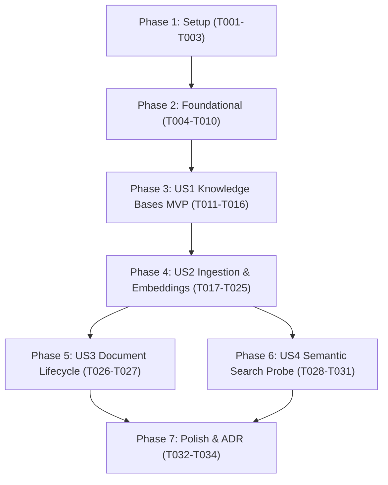

# Tasks: Knowledge Base Management & Document Ingestion

**Input**: Design documents from `specs/001-knowledge-base-management/` (`plan.md`, `spec.md`, `research.md`, `data-model.md`, `contracts/api-spec.yaml`, `quickstart.md`)

**Prerequisites**: Constitution v1.0.0, Docker & Docker Compose, Python 3.11+/3.14

**Organization**: Tasks are grouped into sequential Setup, Foundational, and User Story phases to guarantee atomic implementation, testability, and incremental MVP delivery.

## Format: `[ID] [P?] [Story] Description`
- **[P]**: Can run in parallel (different files, no direct dependencies)
- **[Story]**: User story mapping (`US1`, `US2`, `US3`, `US4`)
- Exact file paths are provided for each task

---

## Phase 1: Setup (Shared Infrastructure)

**Purpose**: Project initialization and basic dependencies configuration.

- [ ] **T001** Criar estrutura de diretórios do backend (`backend/app/{api/v1,core,db,models,schemas,services}`, `backend/alembic`, `backend/tests/{unit,integration}`)
- [ ] **T002** Definir dependências do backend em `backend/requirements.txt` (`fastAPI`, `uvicorn`, `pydantic-settings`, `sqlalchemy>=2.0`, `asyncpg`, `alembic`, `pgvector`, `pypdf`, `google-genai`, `pytest`, `pytest-asyncio`, `httpx`)
- [ ] **T003** [P] Criar configuração do Docker Compose em `docker-compose.yml` na raiz com serviço PostgreSQL 16 + extensão pgvector

---

## Phase 2: Foundational (Blocking Prerequisites)

**Purpose**: Core infrastructure that MUST be complete before ANY user story can be implemented.

- [ ] **T004** Implementar gerenciamento de configurações em `backend/app/core/config.py` utilizando Pydantic BaseSettings para carregar variáveis do `.env`
- [ ] **T005** [P] Implementar tratamento padronizado de exceções e formatador de erros HTTP em `backend/app/core/exceptions.py`
- [ ] **T006** [P] Configurar conexão de banco assíncrona SQLAlchemy (`AsyncSession`, `create_async_engine`) e dependência `get_db` em `backend/app/db/session.py` e `backend/app/db/base.py`
- [ ] **T007** Configurar Alembic para migrações assíncronas com suporte a `pgvector` em `backend/alembic.ini` e `backend/alembic/env.py`
- [ ] **T008** Criar migração inicial Alembic para habilitar a extensão vetorial (`CREATE EXTENSION IF NOT EXISTS vector`) em `backend/alembic/versions/0001_enable_pgvector.py`
- [ ] **T009** Criar inicializador da aplicação FastAPI com middleware CORS e prefixo `/api/v1` em `backend/app/main.py`
- [ ] **T010** [P] Configurar fixtures do pytest e cliente assíncrono `AsyncClient` em `backend/tests/conftest.py`

**Checkpoint**: Infraestrutura básica e conexão com banco de dados operacionais. A implementação das User Stories pode ser iniciada.

---

## Phase 3: User Story 1 - Create and Manage Knowledge Bases (Priority: P1) 🎯 MVP

**Goal**: Permitir aos usuários criar, listar, obter detalhes e excluir coleções temáticas isoladas de conhecimento.

**Independent Test**: Criar uma base de conhecimento via `POST /api/v1/knowledge-bases`, consultar via `GET /api/v1/knowledge-bases` e confirmar persistência com dados válidos e tratamento de nomes duplicados.

- [ ] **T011** [P] [US1] Criar modelo SQLAlchemy `KnowledgeBase` em `backend/app/models/knowledge_base.py`
- [ ] **T012** [P] [US1] Criar schemas Pydantic de Knowledge Base (`KnowledgeBaseCreate`, `KnowledgeBaseResponse`) em `backend/app/schemas/knowledge_base.py`
- [ ] **T013** [US1] Criar migração Alembic para criação da tabela `knowledge_bases` em `backend/alembic/versions/0002_create_knowledge_bases.py`
- [ ] **T014** [P] [US1] Escrever testes de integração para o CRUD de bases de conhecimento em `backend/tests/integration/test_knowledge_bases.py`
- [ ] **T015** [US1] Implementar serviço de lógica de negócios `KnowledgeBaseService` em `backend/app/services/knowledge_base_service.py`
- [ ] **T016** [US1] Implementar endpoints REST `/api/v1/knowledge-bases` em `backend/app/api/v1/knowledge_bases.py` e registrar no router agregador em `backend/app/api/v1/router.py`

**Checkpoint**: User Story 1 (MVP) completamente funcional e testável de forma independente.

---

## Phase 4: User Story 2 - Upload and Ingest Documents with Semantic Embeddings (Priority: P1)

**Goal**: Ingestão de documentos (PDF, TXT, MD), extração de texto, chunking semântico com overlap, geração de embeddings com Google Gemini (`text-embedding-004`) e armazenamento no pgvector.

**Independent Test**: Fazer upload de um arquivo PDF/TXT para uma base de conhecimento existente, verificar a transição para status `completed` e validar que chunks e vetores de 768 dimensões foram gravados.

- [ ] **T017** [P] [US2] Implementar extrator de texto para PDF (`pypdf`), TXT e Markdown com sanitização em `backend/app/services/document_parser.py`
- [ ] **T018** [P] [US2] Implementar chunker recursivo de caracteres (`chunk_size=500`, `chunk_overlap=100`) em `backend/app/services/text_chunker.py`
- [ ] **T019** [P] [US2] Implementar cliente assíncrono para a API Google Gemini gerando embeddings com `text-embedding-004` (768 dimensões) em `backend/app/services/gemini_client.py`
- [ ] **T020** [P] [US2] Criar modelos SQLAlchemy `Document` e `DocumentChunk` (com coluna `Vector(768)` e integridade `ON DELETE CASCADE`) em `backend/app/models/document.py` e `backend/app/models/document_chunk.py`
- [ ] **T021** [P] [US2] Criar schemas Pydantic de documentos (`DocumentResponse`, `DocumentStatusEnum`) em `backend/app/schemas/document.py`
- [ ] **T022** [US2] Criar migração Alembic para tabelas `documents` e `document_chunks` com índice HNSW vetorial em `backend/alembic/versions/0003_create_documents_and_chunks.py`
- [ ] **T023** [P] [US2] Escrever testes unitários para o extrator de documentos e para o algoritmo de chunking em `backend/tests/unit/test_parser.py` e `backend/tests/unit/test_chunker.py`
- [ ] **T024** [US2] Implementar serviço orquestrador `IngestionService` (parse $\rightarrow$ chunk $\rightarrow$ embed $\rightarrow$ persistência atômica) em `backend/app/services/ingestion_service.py`
- [ ] **T025** [US2] Implementar endpoint multipart `POST /api/v1/knowledge-bases/{kb_id}/documents` com validação de formato e tamanho em `backend/app/api/v1/documents.py`

**Checkpoint**: Ingestão completa de documentos e pipeline vetorial funcionando perfeitamente.

---

## Phase 5: User Story 3 - Document Management & Lifecycle (Priority: P2)

**Goal**: Permitir visualização de documentos associados a uma base, consulta de status de processamento e deleção em cascata garantindo ausência de chunks órfãos.

**Independent Test**: Listar documentos de uma base via `GET /api/v1/knowledge-bases/{kb_id}/documents`, deletar um documento via `DELETE` e verificar no banco que todos os chunks vetoriais associados foram expurgados.

- [ ] **T026** [P] [US3] Implementar endpoints de listagem de documentos e remoção de documento em `backend/app/api/v1/documents.py`
- [ ] **T027** [P] [US3] Escrever testes de integração validando listagem de documentos, consulta de status e exclusão em cascata em `backend/tests/integration/test_document_lifecycle.py`

**Checkpoint**: Ciclo de vida completo dos documentos validado.

---

## Phase 6: User Story 4 - Semantic Similarity Search Probe (Priority: P2)

**Goal**: Permitir busca semântica por similaridade de cosseno contra os chunks vetorizados de uma base de conhecimento, retornando trechos ranqueados com scores e metadados de fonte.

**Independent Test**: Submeter uma query textual em `POST /api/v1/knowledge-bases/{kb_id}/search` e validar o retorno dos top-K chunks ranqueados com pontuações de similaridade adequadas e metadados do documento de origem.

- [ ] **T028** [P] [US4] Criar schemas Pydantic para requisição e resposta de busca (`SimilaritySearchRequest`, `SimilaritySearchResult`) em `backend/app/schemas/search.py`
- [ ] **T029** [US4] Implementar método de consulta vetorial por similaridade de cosseno utilizando o operador `<=>` do pgvector em `backend/app/services/ingestion_service.py`
- [ ] **T030** [US4] Implementar endpoint `POST /api/v1/knowledge-bases/{kb_id}/search` em `backend/app/api/v1/documents.py`
- [ ] **T031** [P] [US4] Escrever testes de integração para a rota de busca semântica em `backend/tests/integration/test_similarity_search.py`

**Checkpoint**: Sonda de busca semântica operacional e testada.

---

## Phase 7: Polish & Cross-Cutting Concerns

**Purpose**: Documentação técnica final, conteinerização e verificação de conformidade.

- [ ] **T032** [P] Redigir Architectural Decision Record (ADR) sobre a estratégia de pgvector e chunking em `docs/adr/0001-pgvector-and-chunking-strategy.md`
- [ ] **T033** [P] Criar Dockerfile de produção para a aplicação backend em `backend/Dockerfile`
- [ ] **T034** Executar validação completa do guia `specs/001-knowledge-base-management/quickstart.md` contra o ambiente Docker local

---

## Dependencies & Execution Order

### Regras de Paralelismo:
- Dentro de cada fase, tarefas com marcação **[P]** operam em arquivos isolados e podem ser desenvolvidas simultaneamente.
- Testes unitários e de integração são desenvolvidos em conjunto ou previamente a cada endpoint correspondente.
- Nenhuma User Story é iniciada antes da conclusão da Fase 2 (Foundational).

---

## Implementation Strategy

1. **Passo 1 (Fundação)**: Subir Docker Compose (PostgreSQL com pgvector) e criar estrutura inicial do backend.
2. **Passo 2 (MVP US1)**: Entregar CRUD de Knowledge Bases funcional e testado.
3. **Passo 3 (Pipeline RAG US2 & US4)**: Entregar extrator, chunker, cliente Gemini e busca semântica pgvector.
4. **Passo 4 (Refinamento US3 & Polish)**: Ciclo de vida completo e documentação didática em ADR.
