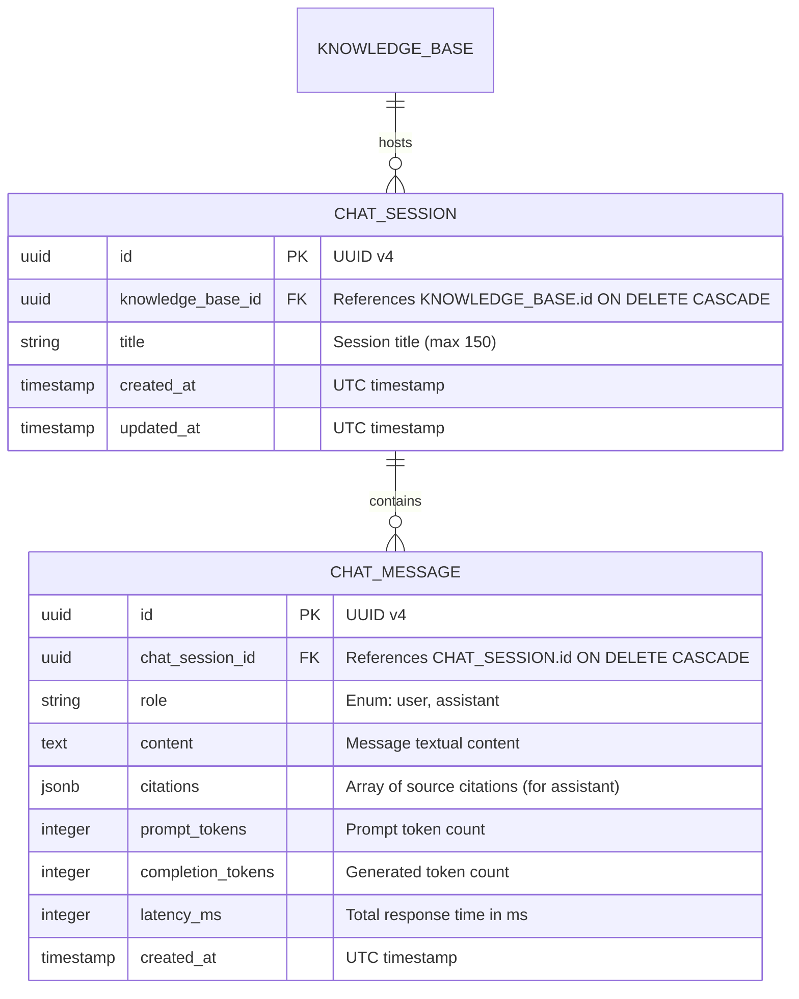

# Data Model: Conversational RAG & Chatbot Engine

**Feature**: `002-conversational-rag-chat`  
**Date**: 2026-11-13  
**Status**: Completed  

---

## 1. Diagrama Entidade-Relacionamento (ERD)



---

## 2. Especificação Detalhada das Tabelas

### 2.1 Tabela `chat_sessions`
Representa um diálogo continuado dentro do contexto de uma base de conhecimento.

| Coluna | Tipo SQL | Restrições | Descrição |
| :--- | :--- | :--- | :--- |
| `id` | `UUID` | Primary Key, Default: `gen_random_uuid()` | Identificador universal único da sessão. |
| `knowledge_base_id` | `UUID` | NOT NULL, FK $\rightarrow$ `knowledge_bases.id` `ON DELETE CASCADE` | Base à qual o chat pertence. |
| `title` | `VARCHAR(150)` | NOT NULL, Default: `'Nova Conversa'` | Título amigável da sessão. |
| `created_at` | `TIMESTAMPTZ` | NOT NULL, Default: `NOW()` | Data de criação em UTC. |
| `updated_at` | `TIMESTAMPTZ` | NOT NULL, Default: `NOW()` | Data da última interação em UTC. |

---

### 2.2 Tabela `chat_messages`
Armazena cada mensagem enviada pelo usuário ou gerada pelo assistente.

| Coluna | Tipo SQL | Restrições | Descrição |
| :--- | :--- | :--- | :--- |
| `id` | `UUID` | Primary Key, Default: `gen_random_uuid()` | Identificador universal único da mensagem. |
| `chat_session_id` | `UUID` | NOT NULL, FK $\rightarrow$ `chat_sessions.id` `ON DELETE CASCADE` | Sessão de chat proprietária. |
| `role` | `VARCHAR(20)` | NOT NULL | Remetente da mensagem: `'user'` ou `'assistant'`. |
| `content` | `TEXT` | NOT NULL | Conteúdo em texto da mensagem. |
| `citations` | `JSONB` | NOT NULL, Default: `'[]'::jsonb` | Array de fontes citadas com metadados dos chunks. |
| `prompt_tokens` | `INTEGER` | NULLABLE | Quantidade de tokens de entrada. |
| `completion_tokens` | `INTEGER` | NULLABLE | Quantidade de tokens gerados. |
| `latency_ms` | `INTEGER` | NULLABLE | Tempo de processamento em milissegundos. |
| `created_at` | `TIMESTAMPTZ` | NOT NULL, Default: `NOW()` | Data e hora de envio em UTC. |

---

## 3. Estrutura do Campo `citations` (JSONB)

Cada item do array `citations` armazena:
```json
{
  "chunk_id": "9b1deb4d-3b7d-4bad-9bdd-2b0d7b3dcb6d",
  "document_id": "c1f2e3d4-b5a6-4f7e-8d9c-0a1b2c3d4e5f",
  "document_name": "manual_tecnico.pdf",
  "chunk_index": 0,
  "similarity_score": 0.8842,
  "content_snippet": "Primeiros 150 caracteres do trecho de texto..."
}
```

---

## 4. Índices e Integridade Referencial

1. **Índice Estrangeiro e de Ordenação**:
   - `idx_chat_sessions_kb_id` em `chat_sessions(knowledge_base_id)`
   - `idx_chat_messages_session_created` em `chat_messages(chat_session_id, created_at)`
2. **Deleção em Cascata**:
   - A exclusão de uma base de conhecimento remove atomicamente todas as suas sessões e mensagens (`ON DELETE CASCADE`).
   - A exclusão de uma sessão remove atomicamente todas as suas mensagens.
