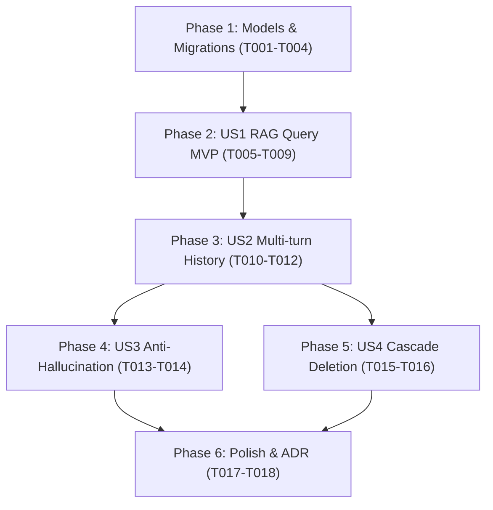

# Tasks: Conversational RAG & Chatbot Engine

**Input**: Design documents from `specs/002-conversational-rag-chat/` (`plan.md`, `spec.md`, `research.md`, `data-model.md`, `contracts/chat-api.yaml`, `quickstart.md`)

**Prerequisites**: Constitution v1.0.0, Feature 001 implemented (KnowledgeBase, Document, DocumentChunk with pgvector)

**Organization**: Tasks are grouped into sequential Setup/Foundational, User Story phases (P1/P2), and Polish to ensure independent testability and incremental MVP delivery.

## Format: `[ID] [P?] [Story] Description`
- **[P]**: Can run in parallel (different files, no direct dependencies)
- **[Story]**: User story mapping (`US1`, `US2`, `US3`, `US4`)
- Exact file paths are provided for each task

---

## Phase 1: Setup & Foundational (Data Model & Schemas)

**Purpose**: Core data infrastructure and schemas that all chat stories depend on.

- [ ] **T001** [P] Criar modelo SQLAlchemy `ChatSession` em `backend/app/models/chat_session.py`
- [ ] **T002** [P] Criar modelo SQLAlchemy `ChatMessage` em `backend/app/models/chat_message.py`
- [ ] **T003** Registrar novos modelos em `backend/app/models/__init__.py` e criar migração Alembic em `backend/alembic/versions/0004_create_chat_tables.py`
- [ ] **T004** [P] Criar schemas Pydantic de Chat (`ChatSessionCreate`, `ChatSessionResponse`, `ChatSessionDetailResponse`, `SendMessageRequest`, `CitationItem`, `ChatMessageResponse`) em `backend/app/schemas/chat.py`

**Checkpoint**: Modelos e migração de banco prontos para as User Stories de Chat.

---

## Phase 2: User Story 1 - Conversational RAG Query with Citations (Priority: P1) 🎯 MVP

**Goal**: Permitir submeter uma pergunta em uma sessão de chat e receber resposta sintetizada pelo Gemini Flash com citações explícitas de chunks da base de conhecimento.

**Independent Test**: Submeter `POST /api/v1/knowledge-bases/{kb_id}/chats/{chat_id}/messages` com uma pergunta sobre documento existente e validar retorno com texto fundamentado, array `citations` com metadados do documento e métricas de tokens.

- [ ] **T005** [P] [US1] Expandir `GeminiEmbeddingClient` / criar `GeminiChatClient` em `backend/app/services/gemini_client.py` com suporte à geração assíncrona de chat via Gemini 2.5 Flash
- [ ] **T006** [US1] Implementar formatador de prompt com delimitação `<context>...</context>` anti-alucinação e anti-injection em `backend/app/services/rag_chat_service.py`
- [ ] **T007** [US1] Implementar método `send_message` orquestrando busca vetorial no pgvector + histórico + Gemini + retorno de citações em `backend/app/services/rag_chat_service.py`
- [ ] **T008** [US1] Implementar endpoint `POST /api/v1/knowledge-bases/{kb_id}/chats/{chat_id}/messages` em `backend/app/api/v1/chat.py` e registrar no router agregador `backend/app/api/v1/router.py`
- [ ] **T009** [P] [US1] Escrever testes de integração para o pipeline RAG de resposta com citação de fontes em `backend/tests/integration/test_chat_rag.py`

**Checkpoint**: Respostas RAG sintetizadas com fontes citadas operacionais e testadas.

---

## Phase 3: User Story 2 - Chat Sessions & Multi-Turn History (Priority: P1)

**Goal**: Permitir criação de sessões de chat, consulta de histórico completo e continuidade conversacional multi-turn via janela deslizante de mensagens.

**Independent Test**: Criar sessão via `POST /chats`, enviar duas perguntas em sequência (uma referenciando a anterior) e verificar que o histórico completo é persistido e retornado em `GET /chats/{chat_id}`.

- [ ] **T010** [P] [US2] Implementar endpoints de criação (`POST /chats`), detalhes com histórico completo (`GET /chats/{chat_id}`) e listagem (`GET /chats`) em `backend/app/api/v1/chat.py`
- [ ] **T011** [US2] Integrar janela deslizante de histórico recente ($K=6$ mensagens) no `RAGChatService` para manter contexto conversacional multi-turn
- [ ] **T012** [P] [US2] Escrever testes de integração validando a preservação do histórico de mensagens e continuidade conversacional em `backend/tests/integration/test_chat_history.py`

**Checkpoint**: Histórico e continuidade conversacional multi-turn funcionando.

---

## Phase 4: User Story 3 - Anti-Hallucination & Edge Case Handling (Priority: P2)

**Goal**: Garantir que o chatbot admita a ausência de resposta quando os documentos da base não cobrirem o tema indagado, com zero alucinação não fundamentada.

**Independent Test**: Enviar pergunta sobre tópico inexistente ou para base vazia e verificar que o assistente declara explicitamente a ausência de dados sem inventar fatos.

- [ ] **T013** [US3] Implementar validação e resposta elegante para bases vazias ou consultas sem trechos correspondentes no `RAGChatService`
- [ ] **T014** [P] [US3] Escrever testes unitários e de integração validando a recusa a alucinar quando dados estão ausentes em `backend/tests/integration/test_anti_hallucination.py`

**Checkpoint**: Guardrails anti-alucinação validados.

---

## Phase 5: User Story 4 - Session Management & Cascade Deletion (Priority: P2)

**Goal**: Permitir exclusão de sessões de conversa com expurgo atômico de todas as mensagens associadas.

**Independent Test**: Deletar sessão via `DELETE /chats/{chat_id}` e confirmar remoção completa no banco sem registros órfãos.

- [ ] **T015** [US4] Implementar endpoint de exclusão de sessão (`DELETE /chats/{chat_id}`) no `backend/app/api/v1/chat.py`
- [ ] **T016** [P] [US4] Escrever teste de integração validando a deleção em cascata de sessões e mensagens em `backend/tests/integration/test_chat_deletion.py`

**Checkpoint**: Ciclo de vida completo das sessões de chat validado.

---

## Phase 6: Polish & Cross-Cutting Concerns

**Purpose**: Documentação técnica e validação geral.

- [ ] **T017** [P] Registrar Architectural Decision Record sobre Prompt Engineering e Defesa Anti-Alucinação em `docs/adr/0002-prompt-engineering-and-anti-hallucination.md`
- [ ] **T018** Validar fluxo ponta a ponta seguindo o guia `specs/002-conversational-rag-chat/quickstart.md`

---

## Dependencies & Execution Order

### Regras de Paralelismo:
- Modelos e Schemas em Phase 1 podem ser criados em paralelo (`[P]`).
- Testes de integração em cada fase são desenvolvidos em arquivos dedicados.
- Cada User Story é entregue e testada de forma incremental.
