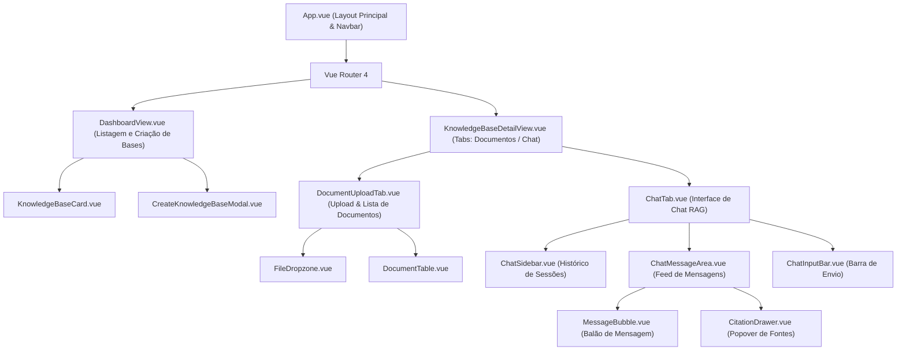

# Data Model & Component Architecture: Frontend Knowledge Base & Chat UI

**Feature**: `003-frontend-rag-ui`  
**Date**: 2026-11-13  
**Status**: Completed  

---

## 1. Arquitetura de Componentes da SPA



---

## 2. Tipos e Modelos de Dados no Frontend (`src/types/index.ts`)

### 2.1 Entidade Knowledge Base
```typescript
export interface KnowledgeBase {
  id: string;
  name: string;
  description: string | null;
  document_count: number;
  created_at: string;
  updated_at: string;
}

export interface KnowledgeBaseCreatePayload {
  name: string;
  description?: string;
}
```

### 2.2 Entidade Document
```typescript
export type DocumentStatus = 'pending' | 'processing' | 'completed' | 'failed';

export interface DocumentItem {
  id: string;
  knowledge_base_id: string;
  filename: string;
  content_type: string;
  file_size_bytes: number;
  status: DocumentStatus;
  error_message: string | null;
  chunk_count: number;
  created_at: string;
  updated_at: string;
}
```

### 2.3 Entidades Chat Session & Message
```typescript
export interface ChatSession {
  id: string;
  knowledge_base_id: string;
  title: string;
  message_count: number;
  created_at: string;
  updated_at: string;
}

export interface CitationItem {
  chunk_id: string;
  document_id: string;
  document_name: string;
  chunk_index: number;
  similarity_score: number;
  content_snippet: string;
}

export interface ChatMessage {
  id: string;
  chat_session_id: string;
  role: 'user' | 'assistant';
  content: string;
  citations: CitationItem[];
  prompt_tokens?: number | null;
  completion_tokens?: number | null;
  latency_ms?: number | null;
  created_at: string;
}

export interface ChatSessionDetail extends ChatSession {
  messages: ChatMessage[];
}
```

---

## 3. Estrutura das Lojas Pinia (Stores)

### 3.1 `knowledgeBaseStore`
- **State**:
  - `knowledgeBases: KnowledgeBase[]`
  - `currentKnowledgeBase: KnowledgeBase | null`
  - `documents: DocumentItem[]`
  - `isLoading: boolean`
  - `error: string | null`
- **Actions**:
  - `fetchKnowledgeBases()`: Carrega lista via `GET /api/v1/knowledge-bases`
  - `createKnowledgeBase(payload)`: Cria nova base via `POST /api/v1/knowledge-bases`
  - `deleteKnowledgeBase(id)`: Remove via `DELETE /api/v1/knowledge-bases/{id}`
  - `fetchDocuments(kbId)`: Carrega documentos via `GET /api/v1/knowledge-bases/{kbId}/documents`
  - `uploadDocument(kbId, file)`: Upload multipart via `POST /api/v1/knowledge-bases/{kbId}/documents`
  - `deleteDocument(kbId, docId)`: Remove documento via `DELETE /api/v1/knowledge-bases/{kbId}/documents/{docId}`

### 3.2 `chatStore`
- **State**:
  - `sessions: ChatSession[]`
  - `currentSession: ChatSessionDetail | null`
  - `isThinking: boolean`
  - `error: string | null`
- **Actions**:
  - `fetchSessions(kbId)`: Carrega sessões via `GET /api/v1/knowledge-bases/{kbId}/chats`
  - `createSession(kbId, title?)`: Cria sessão via `POST /api/v1/knowledge-bases/{kbId}/chats`
  - `loadSession(kbId, sessionId)`: Busca detalhes e histórico via `GET /api/v1/knowledge-bases/{kbId}/chats/{sessionId}`
  - `sendMessage(kbId, sessionId, content)`: Envia pergunta e adiciona resposta com citações via `POST /api/v1/knowledge-bases/{kbId}/chats/{sessionId}/messages`
  - `deleteSession(kbId, sessionId)`: Remove sessão via `DELETE /api/v1/knowledge-bases/{kbId}/chats/{sessionId}`
