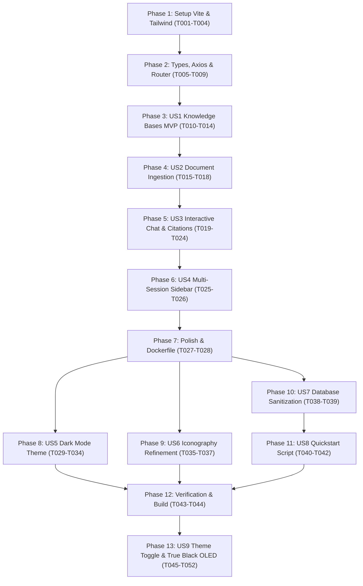

# Tasks: Frontend Knowledge Base & Interactive Chat UI

**Input**: Design documents from `specs/003-frontend-rag-ui/` (`plan.md`, `spec.md`, `research.md`, `data-model.md`, `contracts/frontend-contracts.ts`, `quickstart.md`)

**Prerequisites**: Constitution v1.0.0, Node.js 20+, Backend API operational at `http://localhost:8000/api/v1`

**Organization**: Tasks are grouped into sequential Setup, Foundational, and User Story phases (P1/P2) to enable independent implementation and testability.

## Format: `[ID] [P?] [Story] Description`
- **[P]**: Can run in parallel (different files, no direct dependencies)
- **[Story]**: User story mapping (`US1`, `US2`, `US3`, `US4`)
- Exact file paths are provided for each task

---

## Phase 1: Setup (Frontend Project Scaffolding)

**Purpose**: Project initialization, npm dependencies and build tooling configuration.

- [x] **T001** Criar estrutura de diretórios do frontend (`frontend/src/{assets,components,views,stores,router,services,types}`)
- [x] **T002** Criar `frontend/package.json` com scripts (`dev`, `build`, `preview`) e dependências pinadas (`vue`, `pinia`, `vue-router`, `axios`, `lucide-vue-next`, `marked`, `tailwindcss`, `vite`, `typescript`)
- [x] **T003** [P] Configurar `vite.config.ts`, `tsconfig.json`, `tailwind.config.js`, `postcss.config.js` e `index.html` em `frontend/`
- [x] **T004** [P] Configurar diretivas do Tailwind CSS em `frontend/src/assets/main.css`

**Checkpoint**: Ambiente base do Vite configurado e pronto para compilação.

---

## Phase 2: Foundational (Types, Axios Client & Routing)

**Purpose**: Core infrastructure that all UI views and components depend on.

- [x] **T005** [P] Definir tipos e interfaces TypeScript em `frontend/src/types/index.ts` espelhando 100% dos contratos OpenAPI do backend
- [x] **T006** [P] Implementar cliente HTTP Axios com interceptor de tratamento padronizado de erros em `frontend/src/services/api.ts`
- [x] **T007** Configurar rotas do Vue Router (`/` para Dashboard, `/knowledge-bases/:id` para Detalhes) em `frontend/src/router/index.ts`
- [x] **T008** Implementar ponto de entrada `frontend/src/main.ts` montando a aplicação Vue com Pinia e Router
- [x] **T009** [P] Implementar layout raiz e barra de navegação responsiva em `frontend/src/App.vue` e `frontend/src/components/Navbar.vue`

**Checkpoint**: Fundação pronta - roteamento, tipagem e cliente HTTP operacionais.

---

## Phase 3: User Story 1 - Knowledge Bases Dashboard (Priority: P1) 🎯 MVP

**Goal**: Permitir visualizar todas as bases de conhecimento em grade/cartões, criar novas bases via modal interativo e navegar para a base selecionada.

**Independent Test**: Acessar a aplicação, abrir o modal "Nova Base", preencher nome/descrição, salvar e verificar que o cartão é inserido instantaneamente no dashboard com badge de contagem de documentos.

- [x] **T010** [P] [US1] Implementar serviço HTTP `knowledgeBaseService.ts` em `frontend/src/services/knowledgeBaseService.ts`
- [x] **T011** [US1] Implementar loja Pinia `knowledgeBaseStore.ts` com ações para carregar e criar bases em `frontend/src/stores/knowledgeBaseStore.ts`
- [x] **T012** [P] [US1] Criar componente de cartão `KnowledgeBaseCard.vue` em `frontend/src/components/KnowledgeBaseCard.vue`
- [x] **T013** [P] [US1] Criar modal de criação de base de conhecimento `CreateKBModal.vue` com validação de campos em `frontend/src/components/CreateKBModal.vue`
- [x] **T014** [US1] Implementar tela de Dashboard `DashboardView.vue` agregando lista de bases e modal em `frontend/src/views/DashboardView.vue`

**Checkpoint**: User Story 1 (MVP) completamente funcional e testável de forma independente.

---

## Phase 4: User Story 2 - Document Upload & Ingestion Monitoring (Priority: P1)

**Goal**: Permitir upload de arquivos (PDF, TXT, MD) via drag-and-drop e monitoramento do status de processamento vetorial em tempo real.

**Independent Test**: Acessar uma base de conhecimento, arrastar um documento PDF/MD para o dropzone, verificar a adição à tabela com status "processing" e atualização para "completed" com número de chunks.

- [x] **T015** [US2] Expandir `knowledgeBaseStore.ts` com ações de upload multipart, listagem e remoção de documentos
- [x] **T016** [P] [US2] Criar componente de drag-and-drop `FileDropzone.vue` com validação visual de formato e tamanho em `frontend/src/components/FileDropzone.vue`
- [x] **T017** [P] [US2] Criar componente de tabela `DocumentTable.vue` com badges de status coloridos e ação de remoção em `frontend/src/components/DocumentTable.vue`
- [x] **T018** [US2] Criar aba de documentos dentro de `KnowledgeBaseDetailView.vue` em `frontend/src/views/KnowledgeBaseDetailView.vue`

**Checkpoint**: Ingestão e monitoramento de documentos funcionando na interface.

---

## Phase 5: User Story 3 - Interactive Chat with Grounded Citations (Priority: P1)

**Goal**: Permitir diálogo em tempo real com o chatbot RAG, renderizando balões estilizados, formatação Markdown e pills clicáveis de fontes com scores de relevância.

**Independent Test**: Abrir aba de chat em uma base com documentos, submeter pergunta, observar indicador de digitação, verificar renderização da resposta e clicar na fonte para abrir o popover com o trecho original.

- [x] **T019** [P] [US3] Implementar serviço HTTP `chatService.ts` para envio de mensagens e sessões em `frontend/src/services/chatService.ts`
- [x] **T020** [US3] Implementar loja Pinia `chatStore.ts` para gerenciar mensagens, citações e estado de digitação (*isThinking*) em `frontend/src/stores/chatStore.ts`
- [x] **T021** [P] [US3] Criar componente de balão de mensagem `MessageBubble.vue` com renderização de markdown e pills de citação em `frontend/src/components/MessageBubble.vue`
- [x] **T022** [P] [US3] Criar modal/popover de detalhes da citação `CitationModal.vue` em `frontend/src/components/CitationModal.vue`
- [x] **T023** [P] [US3] Criar barra de entrada de texto e botão de envio `ChatInputBar.vue` em `frontend/src/components/ChatInputBar.vue`
- [x] **T024** [US3] Integrar aba de Chat na tela `KnowledgeBaseDetailView.vue`

**Checkpoint**: Experiência conversacional RAG completa com citações operando na UI.

---

## Phase 6: User Story 4 - Multi-Session Navigation & Deletion (Priority: P2)

**Goal**: Permitir alternar entre múltiplas sessões de conversa na barra lateral e excluir sessões com diálogo de confirmação.

**Independent Test**: Criar nova sessão na barra lateral, alternar entre a sessão 1 e sessão 2, verificar a troca instantânea do histórico e deletar a sessão 1.

- [x] **T025** [P] [US4] Criar componente de barra lateral `ChatSidebar.vue` com lista de conversas e botão "Nova Conversa" em `frontend/src/components/ChatSidebar.vue`
- [x] **T026** [US4] Integrar alternância e exclusão de sessões no `ChatSidebar.vue` e `chatStore.ts`

**Checkpoint**: Navegação e gerenciamento multi-sessão validados.

---

## Phase 7: Polish & Docker Production

**Purpose**: Conteinerização de produção e validação de build estático.

- [x] **T027** [P] Criar Dockerfile de produção com servidor Nginx e configuração de SPA routing em `frontend/Dockerfile` e `frontend/nginx.conf`
- [x] **T028** Executar validação de compilação TypeScript com `npm run build`

---

## Phase 8: User Story 5 - Dark Mode Theme (Priority: P1)

**Goal**: Implementar tema escuro moderno e imersivo (Dark Mode) em toda a aplicação frontend, utilizando paleta dark slate com alto contraste e acabamento profissional.

**Independent Test**: Navegar pelas páginas da aplicação (`/` e `/knowledge-bases/:id`), abrir modais, dropzone e conversas, validando que todas as superfícies utilizam fundos escuros (`bg-slate-950`, `bg-slate-900`), bordas sutis (`border-slate-800`) e tipografia de alto contraste (`text-slate-100`, `text-slate-300`).

- [x] **T029** [P] [US5] Configurar suporte a Dark Mode por padrão no Tailwind e definir estilos base escuros em `frontend/tailwind.config.js` e `frontend/src/assets/main.css`
- [x] **T030** [P] [US5] Atualizar a barra de navegação com superfícies escuras, bordas sutis e tipografia clara em `frontend/src/components/Navbar.vue`
- [x] **T031** [P] [US5] Atualizar Dashboard e cartões de bases de conhecimento para estilo dark com efeitos de hover em `frontend/src/views/DashboardView.vue` e `frontend/src/components/KnowledgeBaseCard.vue`
- [x] **T032** [P] [US5] Atualizar modal de criação de base de conhecimento com backdrop dark, inputs escuros e anéis de foco em `frontend/src/components/CreateKBModal.vue`
- [x] **T033** [P] [US5] Atualizar tela de detalhes da base, dropzone de arquivos e tabela de documentos com tema dark em `frontend/src/views/KnowledgeBaseDetailView.vue`, `frontend/src/components/FileDropzone.vue` e `frontend/src/components/DocumentTable.vue`
- [x] **T034** [P] [US5] Atualizar barra lateral de sessões, balões de chat, barra de input e modal de citação para tema dark em `frontend/src/components/ChatSidebar.vue`, `frontend/src/components/MessageBubble.vue`, `frontend/src/components/ChatInputBar.vue` e `frontend/src/components/CitationModal.vue`

---

## Phase 9: User Story 6 - Iconography Refinement (Sparkles Removal) (Priority: P2)

**Goal**: Remover todas as instâncias do ícone decorativo de brilho (`Sparkles`), substituindo-os por ícones técnicos e sóbrios de engenharia (`Bot`, `BrainCircuit`, `Cpu`, `MessageSquare`).

**Independent Test**: Inspecionar os componentes Vue e telas (`Navbar.vue`, `MessageBubble.vue`, `KnowledgeBaseDetailView.vue`, `DashboardView.vue`) e certificar que nenhum ícone `Sparkles` é renderizado.

- [x] **T035** [P] [US6] Substituir ícone de brilho no logotipo da barra de navegação por Bot ou BrainCircuit em `frontend/src/components/Navbar.vue`
- [x] **T036** [P] [US6] Substituir ícone de brilho no avatar de resposta do assistente por Bot ou Cpu em `frontend/src/components/MessageBubble.vue`
- [x] **T037** [P] [US6] Substituir ícone de brilho nos estados vazios de chat e indicadores de carregamento por MessageSquare ou BrainCircuit em `frontend/src/views/KnowledgeBaseDetailView.vue` e `frontend/src/views/DashboardView.vue`

---

## Phase 10: User Story 7 - Zero-State Database Sanitization (Priority: P1)

**Goal**: Garantir que a base de dados PostgreSQL esteja completamente zerada (tabelas vazias sem registros de teste), preservando as extensões (`vector`) e as migrações estruturais do Alembic.

**Independent Test**: Executar a rotina de sanitização, inspecionar as tabelas (`knowledge_bases`, `documents`, `document_chunks`, `chat_sessions`, `chat_messages`) e validar contagem igual a 0.

- [x] **T038** [US7] Criar script Python de limpeza e truncagem segura de tabelas com CASCADE em `backend/app/scripts/reset_db.py`
- [x] **T039** [US7] Executar limpeza das tabelas do banco de dados para garantir estado zero inicial

---

## Phase 11: User Story 8 - Automated Zero-Friction Quickstart Script (Priority: P1)

**Goal**: Criar script shell interativo na raiz (`start.sh`) que orienta na criação da chave Gemini, permite colar a chave para configurar `.env`, sobe o Docker Compose, roda migrações, oferece opção de zerar banco e executa frontend e backend com parada limpa.

**Independent Test**: Executar `./start.sh` no terminal a partir do zero e validar todo o fluxo interativo, instruções do Google AI Studio, prompt de cola de chave e inicialização simultânea dos serviços.

- [x] **T040** [US8] Implementar script interativo com menu explicativo de geração de chave Gemini e prompt para colar a chave em `start.sh`
- [x] **T041** [US8] Configurar inicialização automatizada de containers Docker, migrações Alembic, servidores locais e tratamento de encerramento gracioso via SIGINT em `start.sh`
- [x] **T042** [P] [US8] Atualizar documentação de execução rápida no `README.md` destacando o script `start.sh`

---

## Phase 12: Polish & Verification

**Purpose**: Verificação cruzada de compilação, integridade de tipos e testes automatizados.

- [x] **T043** [P] Validar compilação estática do frontend Vue/TypeScript com `npm run build` em `frontend/`
- [x] **T044** Executar suíte completa de testes automatizados com `pytest` em `backend/tests/`

---

## Phase 13: User Story 9 - Interactive Theme Toggle & True Black OLED Theme (Priority: P1)

**Goal**: Implementar botão interativo na barra de navegação para alternar entre Modo Claro (branco limpo) e Modo Escuro (preto absoluto / True Black OLED `#000000`), com persistência da preferência do usuário em `localStorage` e ausência de flashes ao recarregar a página.

**Independent Test**: Abrir a aplicação no navegador, clicar no botão Sol/Lua na Navbar e observar a transição imediata entre Modo Claro (branco) e Modo Escuro (preto puro `bg-black` e `bg-zinc-950`). Recarregar a página para certificar que a preferência selecionada persiste sem flicker.

- [x] **T045** [P] [US9] Implementar loja Pinia e gerenciador de tema com persistência em localStorage e toggle da classe `dark` no DOM em `frontend/src/stores/themeStore.ts`
- [x] **T046** [P] [US9] Inserir script inline anti-flicker no `<head>` para carregar o tema salvo antes do primeiro paint em `frontend/index.html`
- [x] **T047** [P] [US9] Implementar botão de alternância de tema (Sol/Lua) e estilização dual-theme (branco no claro, preto puro no escuro) em `frontend/src/components/Navbar.vue`
- [x] **T048** [P] [US9] Refatorar layout raiz e scrollbars para dual-theme com suporte a fundo preto absoluto no modo escuro em `frontend/src/App.vue` e `frontend/src/assets/main.css`
- [x] **T049** [P] [US9] Adaptar Dashboard e cartões de bases com classes dual-theme (branco no claro, preto puro `bg-black`/`bg-zinc-950` no escuro) em `frontend/src/views/DashboardView.vue` e `frontend/src/components/KnowledgeBaseCard.vue`
- [x] **T050** [P] [US9] Adaptar detalhes da base, dropzone, tabela de documentos e modal de criação com classes dual-theme em `frontend/src/views/KnowledgeBaseDetailView.vue`, `frontend/src/components/FileDropzone.vue`, `frontend/src/components/DocumentTable.vue` e `frontend/src/components/CreateKBModal.vue`
- [x] **T051** [P] [US9] Adaptar sidebar de chat, balões de mensagem, barra de envio e modal de citação com classes dual-theme em `frontend/src/components/ChatSidebar.vue`, `frontend/src/components/MessageBubble.vue`, `frontend/src/components/ChatInputBar.vue` e `frontend/src/components/CitationModal.vue`
- [x] **T052** [P] Validar compilação estática do frontend Vue/TypeScript com `npm run build` em `frontend/`

---

## Dependencies & Execution Order



---

## Parallel Execution Opportunities

```bash
# Execução paralela do Dual-Theme (arquivos desacoplados):
Task: "T045 [P] [US9] themeStore.ts"
Task: "T046 [P] [US9] index.html"
Task: "T047 [P] [US9] Navbar.vue com botão Sol/Lua"
Task: "T048 [P] [US9] App.vue e main.css"
Task: "T049 [P] [US9] DashboardView.vue e KnowledgeBaseCard.vue"
Task: "T050 [P] [US9] DetailView, Dropzone, DocumentTable e CreateKBModal"
Task: "T051 [P] [US9] ChatSidebar, MessageBubble, ChatInputBar e CitationModal"
```
