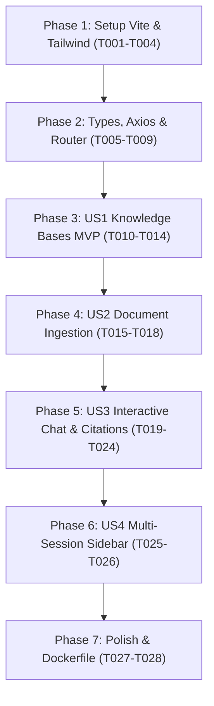

# Tasks: Frontend Knowledge Base & Interactive Chat UI

**Input**: Design documents from `specs/003-frontend-rag-ui/` (`plan.md`, `spec.md`, `research.md`, `data-model.md`, `contracts/frontend-contracts.ts`, `quickstart.md`)

**Prerequisites**: Constitution v1.0.0, Node.js 20+, Backend API operational at `http://localhost:8000/api/v1`

**Organization**: Tasks are grouped into sequential Setup, Foundational, and User Story phases (P1/P2) to enable independent implementation and testability.

## Format: `[ID] [P?] [Story] Description`
- **[P]**: Can run in parallel (different files, no direct dependencies)
- **[Story]**: User story mapping (`US1`, `US2`, `US3`, `US4`)
- Exact file paths are provided for each task

---

## Phase 1: Setup (Frontend Project Scaffolding)

**Purpose**: Project initialization, npm dependencies and build tooling configuration.

- [ ] **T001** Criar estrutura de diretórios do frontend (`frontend/src/{assets,components,views,stores,router,services,types}`)
- [ ] **T002** Criar `frontend/package.json` com scripts (`dev`, `build`, `preview`) e dependências pinadas (`vue`, `pinia`, `vue-router`, `axios`, `lucide-vue-next`, `marked`, `tailwindcss`, `vite`, `typescript`)
- [ ] **T003** [P] Configurar `vite.config.ts`, `tsconfig.json`, `tailwind.config.js`, `postcss.config.js` e `index.html` em `frontend/`
- [ ] **T004** [P] Configurar diretivas do Tailwind CSS em `frontend/src/assets/main.css`

**Checkpoint**: Ambiente base do Vite configurado e pronto para compilação.

---

## Phase 2: Foundational (Types, Axios Client & Routing)

**Purpose**: Core infrastructure that all UI views and components depend on.

- [ ] **T005** [P] Definir tipos e interfaces TypeScript em `frontend/src/types/index.ts` espelhando 100% dos contratos OpenAPI do backend
- [ ] **T006** [P] Implementar cliente HTTP Axios com interceptor de tratamento padronizado de erros em `frontend/src/services/api.ts`
- [ ] **T007** Configurar rotas do Vue Router (`/` para Dashboard, `/knowledge-bases/:id` para Detalhes) em `frontend/src/router/index.ts`
- [ ] **T008** Implementar ponto de entrada `frontend/src/main.ts` montando a aplicação Vue com Pinia e Router
- [ ] **T009** [P] Implementar layout raiz e barra de navegação responsiva em `frontend/src/App.vue` e `frontend/src/components/Navbar.vue`

**Checkpoint**: Fundação pronta - roteamento, tipagem e cliente HTTP operacionais.

---

## Phase 3: User Story 1 - Knowledge Bases Dashboard (Priority: P1) 🎯 MVP

**Goal**: Permitir visualizar todas as bases de conhecimento em grade/cartões, criar novas bases via modal interativo e navegar para a base selecionada.

**Independent Test**: Acessar a aplicação, abrir o modal "Nova Base", preencher nome/descrição, salvar e verificar que o cartão é inserido instantaneamente no dashboard com badge de contagem de documentos.

- [ ] **T010** [P] [US1] Implementar serviço HTTP `knowledgeBaseService.ts` em `frontend/src/services/knowledgeBaseService.ts`
- [ ] **T011** [US1] Implementar loja Pinia `knowledgeBaseStore.ts` com ações para carregar e criar bases em `frontend/src/stores/knowledgeBaseStore.ts`
- [ ] **T012** [P] [US1] Criar componente de cartão `KnowledgeBaseCard.vue` em `frontend/src/components/KnowledgeBaseCard.vue`
- [ ] **T013** [P] [US1] Criar modal de criação de base de conhecimento `CreateKBModal.vue` com validação de campos em `frontend/src/components/CreateKBModal.vue`
- [ ] **T014** [US1] Implementar tela de Dashboard `DashboardView.vue` agregando lista de bases e modal em `frontend/src/views/DashboardView.vue`

**Checkpoint**: User Story 1 (MVP) completamente funcional e testável de forma independente.

---

## Phase 4: User Story 2 - Document Upload & Ingestion Monitoring (Priority: P1)

**Goal**: Permitir upload de arquivos (PDF, TXT, MD) via drag-and-drop e monitoramento do status de processamento vetorial em tempo real.

**Independent Test**: Acessar uma base de conhecimento, arrastar um documento PDF/MD para o dropzone, verificar a adição à tabela com status "processing" e atualização para "completed" com número de chunks.

- [ ] **T015** [US2] Expandir `knowledgeBaseStore.ts` com ações de upload multipart, listagem e remoção de documentos
- [ ] **T016** [P] [US2] Criar componente de drag-and-drop `FileDropzone.vue` com validação visual de formato e tamanho em `frontend/src/components/FileDropzone.vue`
- [ ] **T017** [P] [US2] Criar componente de tabela `DocumentTable.vue` com badges de status coloridos e ação de remoção em `frontend/src/components/DocumentTable.vue`
- [ ] **T018** [US2] Criar aba de documentos dentro de `KnowledgeBaseDetailView.vue` em `frontend/src/views/KnowledgeBaseDetailView.vue`

**Checkpoint**: Ingestão e monitoramento de documentos funcionando na interface.

---

## Phase 5: User Story 3 - Interactive Chat with Grounded Citations (Priority: P1)

**Goal**: Permitir diálogo em tempo real com o chatbot RAG, renderizando balões estilizados, formatação Markdown e pills clicáveis de fontes com scores de relevância.

**Independent Test**: Abrir aba de chat em uma base com documentos, submeter pergunta, observar indicador de digitação, verificar renderização da resposta e clicar na fonte para abrir o popover com o trecho original.

- [ ] **T019** [P] [US3] Implementar serviço HTTP `chatService.ts` para envio de mensagens e sessões em `frontend/src/services/chatService.ts`
- [ ] **T020** [US3] Implementar loja Pinia `chatStore.ts` para gerenciar mensagens, citações e estado de digitação (*isThinking*) em `frontend/src/stores/chatStore.ts`
- [ ] **T021** [P] [US3] Criar componente de balão de mensagem `MessageBubble.vue` com renderização de markdown e pills de citação em `frontend/src/components/MessageBubble.vue`
- [ ] **T022** [P] [US3] Criar modal/popover de detalhes da citação `CitationModal.vue` em `frontend/src/components/CitationModal.vue`
- [ ] **T023** [P] [US3] Criar barra de entrada de texto e botão de envio `ChatInputBar.vue` em `frontend/src/components/ChatInputBar.vue`
- [ ] **T024** [US3] Integrar aba de Chat na tela `KnowledgeBaseDetailView.vue`

**Checkpoint**: Experiência conversacional RAG completa com citações operando na UI.

---

## Phase 6: User Story 4 - Multi-Session Navigation & Deletion (Priority: P2)

**Goal**: Permitir alternar entre múltiplas sessões de conversa na barra lateral e excluir sessões com diálogo de confirmação.

**Independent Test**: Criar nova sessão na barra lateral, alternar entre a sessão 1 e sessão 2, verificar a troca instantânea do histórico e deletar a sessão 1.

- [ ] **T025** [P] [US4] Criar componente de barra lateral `ChatSidebar.vue` com lista de conversas e botão "Nova Conversa" em `frontend/src/components/ChatSidebar.vue`
- [ ] **T026** [US4] Integrar alternância e exclusão de sessões no `ChatSidebar.vue` e `chatStore.ts`

**Checkpoint**: Navegação e gerenciamento multi-sessão validados.

---

## Phase 7: Polish & Docker Production

**Purpose**: Conteinerização de produção e validação de build estático.

- [ ] **T027** [P] Criar Dockerfile de produção com servidor Nginx e configuração de SPA routing em `frontend/Dockerfile` e `frontend/nginx.conf`
- [ ] **T028** Executar validação de compilação TypeScript com `npm run build`

---

## Dependencies & Execution Order

