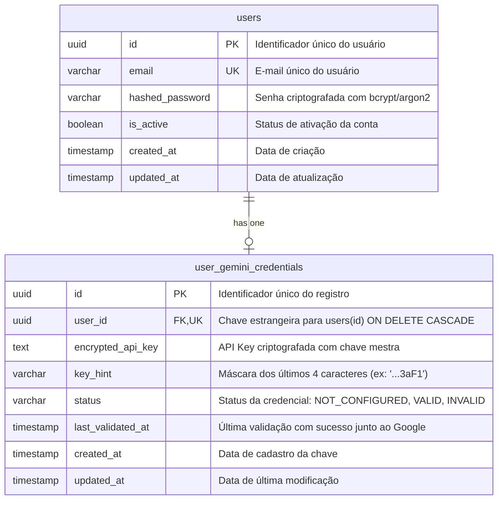

# Data Model: Gerenciamento Seguro de Gemini API Keys

**Feature**: `004-user-gemini-api-keys` | **Date**: 2026-11-13

---

## 1. Diagrama de Entidades (ER)



---

## 2. Descrição das Entidades e Restrições

### 2.1. Entidade `User` (`users`)
- `id`: `UUID`, chave primária, default `uuid.uuid4`.
- `email`: `String(255)`, único, não nulo, indexado. Normalizado em minúsculas.
- `hashed_password`: `String(255)`, não nulo. Hash gerado via algoritmo seguro (bcrypt).
- `is_active`: `Boolean`, default `True`, não nulo.
- `created_at`: `DateTime(timezone=True)`, não nulo.
- `updated_at`: `DateTime(timezone=True)`, não nulo.

### 2.2. Entidade `UserGeminiCredential` (`user_gemini_credentials`)
- `id`: `UUID`, chave primária, default `uuid.uuid4`.
- `user_id`: `UUID`, chave estrangeira para `users.id`, `unique=True`, `nullable=False`, `index=True`, `ondelete="CASCADE"`.
  - *Regra*: Cada usuário pode ter no máximo uma credencial Gemini ativa.
- `encrypted_api_key`: `Text` ou `LargeBinary`, não nulo. Contém a string base64 do ciphertext gerado pelo `EncryptionService`. Nunca contém o segredo em claro.
- `key_hint`: `String(10)`, não nulo. Contém os 4 últimos caracteres da chave original prefixados com reticências (ex: `"...f8K2"`), permitindo identificação visual pelo usuário.
- `status`: `Enum('NOT_CONFIGURED', 'VALID', 'INVALID')`, padrão `'NOT_CONFIGURED'`, não nulo, indexado.
- `last_validated_at`: `DateTime(timezone=True)`, nulo se nunca validada.
- `created_at`: `DateTime(timezone=True)`, não nulo.
- `updated_at`: `DateTime(timezone=True)`, não nulo.

---

## 3. Enums e Validações de Domínio

### `ApiKeyStatus`
```python
class ApiKeyStatus(str, Enum):
    NOT_CONFIGURED = "NOT_CONFIGURED"
    VALID = "VALID"
    INVALID = "INVALID"
```

- `NOT_CONFIGURED`: O usuário foi criado mas não cadastrou nenhuma Gemini API Key.
- `VALID`: Chave cadastrada, validada com sucesso contra o Google Gemini e pronta para uso nas operações RAG.
- `INVALID`: A chave falhou na validação inicial ou foi desativada/revogada pelo Google durante uma chamada em tempo de execução.
