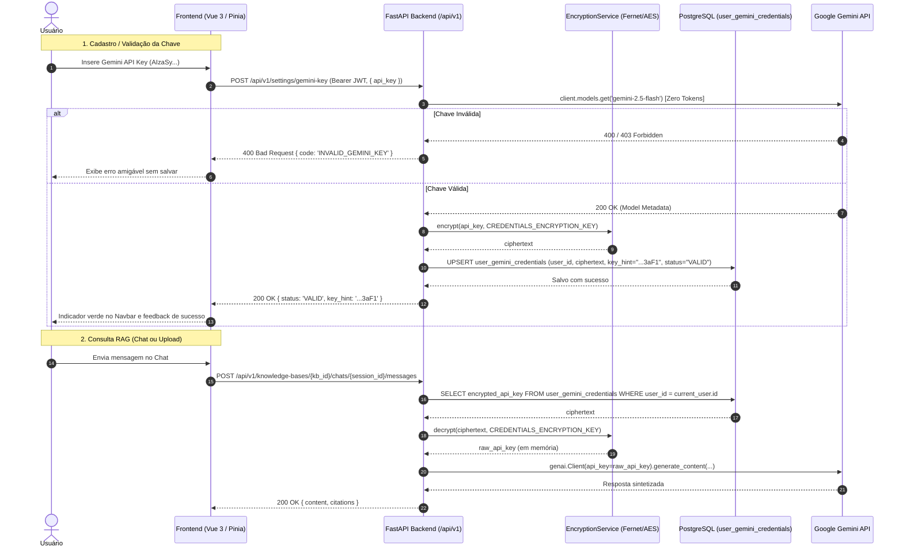

# Implementation Plan: Gerenciamento Individual e Seguro de Gemini API Keys

**Branch**: `004-user-gemini-api-keys` | **Date**: 2026-11-13 | **Spec**: [spec.md](spec.md)

**Input**: Feature specification from `specs/004-user-gemini-api-keys/spec.md`

---

## Summary

Esta funcionalidade introduz o gerenciamento individual e seguro de chaves da Gemini API para cada usuário autenticado no Atlas AI. O backend recebe a chave informada pelo usuário, valida-a sem custo contra os serviços do Google Gemini (`genai.Client.models.get`), criptografa-a utilizando criptografia simétrica com chave mestra isolada (`CREDENTIALS_ENCRYPTION_KEY`) e a armazena no PostgreSQL. Todas as operações RAG (ingestão de documentos com embeddings e respostas conversacionais no chat) passam a utilizar a chave descriptografada em memória do usuário autenticado, sem jamais registrar segredos em logs, respostas HTTP ou frontend.

---

## Technical Context

**Language/Version**: Python 3.11+ / 3.14 (Backend); TypeScript 5+ (Frontend).

**Primary Dependencies**:
- Backend:
  - `cryptography>=43.0.0` (Para criptografia simétrica Fernet / AES-256-GCM).
  - `passlib[bcrypt]>=1.7.4` ou `bcrypt>=4.2.0` (Para hashing seguro de senhas).
  - `pyjwt>=2.9.0` (Para tokens JWT de autenticação).
  - `google-genai>=0.1.1` (Para validação e execução das operações de embedding e chat).
  - `fastapi`, `sqlalchemy`, `pydantic-settings`, `alembic`.
- Frontend:
  - `vue`, `pinia`, `vue-router`, `axios`, `lucide-vue-next`, `tailwindcss`.

**Database & Migrations**:
- PostgreSQL + `pgvector`.
- Migração Alembic: `0005_users_and_credentials.py`.
- Tabelas: `users` e `user_gemini_credentials`.

**Security Architecture**:
- Variável mestra de criptografia no Render: `CREDENTIALS_ENCRYPTION_KEY` (chave Fernet / 256-bit).
- Variável de assinatura de autenticação: `SECRET_KEY` (usada exclusivamente para JWT).
- Sanitização de logs: interceptor que impede logs de valores semelhantes a chaves do Google (`AIzaSy...`).
- Mascaramento: Frontend recebe somente os últimos 4 dígitos no campo `key_hint`.

**Deployment Architecture**:
- **Render (Backend)**: `DATABASE_URL`, `SECRET_KEY`, `CREDENTIALS_ENCRYPTION_KEY`, `BACKEND_CORS_ORIGINS`.
- **Vercel (Frontend)**: `VITE_API_URL` (ou `VITE_API_BASE_URL`).

---

## Architecture & Integration Flow

