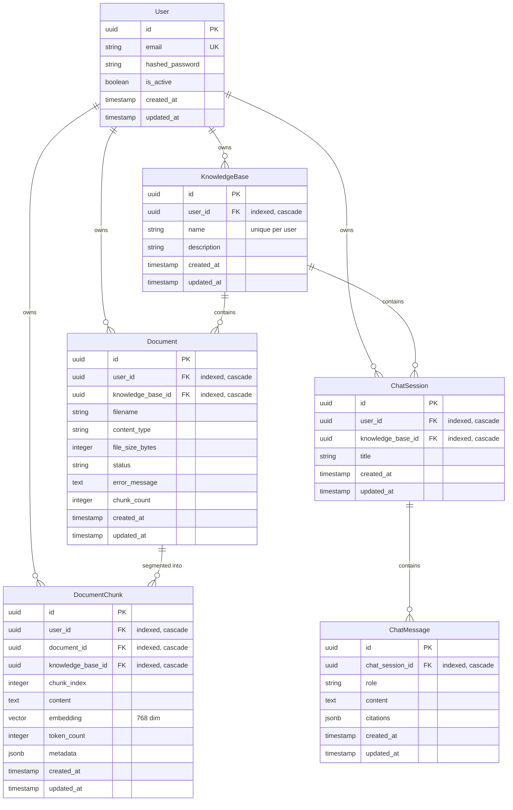

# Data Model: Multi-Tenant Data Isolation

**Feature**: `005-multi-tenant-data-isolation`
**Date**: 2026-11-14
**Status**: Ready

## Entity-Relationship Diagram

---

## Detailed Model Specifications

### 1. `KnowledgeBase` Entity (`knowledge_bases`)
- **Table**: `knowledge_bases`
- **Fields**:
  - `id`: `UUID` (Primary Key, default `uuid4`, indexed)
  - `user_id`: `UUID` (`ForeignKey("users.id", ondelete="CASCADE")`, nullable=False, indexed)
  - `name`: `String(100)` (nullable=False)
  - `description`: `Text` (nullable=True)
  - `created_at`: `DateTime(timezone=True)` (server_default=now())
  - `updated_at`: `DateTime(timezone=True)` (server_default=now(), onupdate=now())
- **Constraints & Indexes**:
  - `uq_knowledge_bases_user_id_name`: `UniqueConstraint('user_id', 'name')` — guarantees uniqueness of folder names per user while allowing identical folder names across different users.
  - `ix_knowledge_bases_user_id`: Index on `user_id` for fast user collection queries.

### 2. `Document` Entity (`documents`)
- **Table**: `documents`
- **Fields**:
  - `id`: `UUID` (Primary Key, default `uuid4`, indexed)
  - `user_id`: `UUID` (`ForeignKey("users.id", ondelete="CASCADE")`, nullable=False, indexed)
  - `knowledge_base_id`: `UUID` (`ForeignKey("knowledge_bases.id", ondelete="CASCADE")`, nullable=False, indexed)
  - `filename`: `String(255)` (nullable=False)
  - `content_type`: `String(50)` (nullable=False)
  - `file_size_bytes`: `Integer` (nullable=False)
  - `status`: `String(20)` (nullable=False, default='pending')
  - `error_message`: `Text` (nullable=True)
  - `chunk_count`: `Integer` (nullable=False, default=0)
  - `created_at`: `DateTime(timezone=True)` (server_default=now())
  - `updated_at`: `DateTime(timezone=True)` (server_default=now(), onupdate=now())
- **Indexes**:
  - `ix_documents_user_id`: Index on `user_id` for direct ownership queries.
  - `ix_documents_knowledge_base_id`: Index on `knowledge_base_id`.

### 3. `DocumentChunk` Entity (`document_chunks`)
- **Table**: `document_chunks`
- **Fields**:
  - `id`: `UUID` (Primary Key, default `uuid4`, indexed)
  - `user_id`: `UUID` (`ForeignKey("users.id", ondelete="CASCADE")`, nullable=False, indexed)
  - `document_id`: `UUID` (`ForeignKey("documents.id", ondelete="CASCADE")`, nullable=False, indexed)
  - `knowledge_base_id`: `UUID` (`ForeignKey("knowledge_bases.id", ondelete="CASCADE")`, nullable=False, indexed)
  - `chunk_index`: `Integer` (nullable=False)
  - `content`: `Text` (nullable=False)
  - `embedding`: `Vector(768)` (dense vector embedding)
  - `token_count`: `Integer` (nullable=False, default=0)
  - `metadata`: `JSONB` (nullable=False, server_default='{}')
  - `created_at`: `DateTime(timezone=True)`
  - `updated_at`: `DateTime(timezone=True)`
- **Indexes**:
  - `ix_document_chunks_user_kb`: Compound index on `(user_id, knowledge_base_id)` for high-speed scoped vector distance calculation.

### 4. `ChatSession` Entity (`chat_sessions`)
- **Table**: `chat_sessions`
- **Fields**:
  - `id`: `UUID` (Primary Key, default `uuid4`, indexed)
  - `user_id`: `UUID` (`ForeignKey("users.id", ondelete="CASCADE")`, nullable=False, indexed)
  - `knowledge_base_id`: `UUID` (`ForeignKey("knowledge_bases.id", ondelete="CASCADE")`, nullable=False, indexed)
  - `title`: `String(150)` (nullable=False, default="Nova Conversa")
  - `created_at`: `DateTime(timezone=True)`
  - `updated_at`: `DateTime(timezone=True)`
- **Indexes**:
  - `ix_chat_sessions_user_id`: Index on `user_id`.
  - `ix_chat_sessions_user_kb`: Compound index on `(user_id, knowledge_base_id)`.

---

## Migration Plan (`0006_multi_tenant_isolation.py`)

1. **Purge Orphan Development Data**:
   - Delete any existing rows in `chat_messages` where `chat_session_id` belongs to a session without an owner.
   - Delete any existing rows in `chat_sessions`, `document_chunks`, `documents`, and `knowledge_bases` that do not have an attributable user.
2. **Schema Alterations**:
   - Add column `user_id` (`UUID`, non-null, FK to `users.id`) to `knowledge_bases`.
   - Add column `user_id` (`UUID`, non-null, FK to `users.id`) to `documents`.
   - Add column `user_id` (`UUID`, non-null, FK to `users.id`) to `document_chunks`.
   - Add column `user_id` (`UUID`, non-null, FK to `users.id`) to `chat_sessions`.
3. **Index & Constraint Updates**:
   - Drop index `ix_knowledge_bases_name`.
   - Add unique constraint `uq_knowledge_bases_user_id_name` on `knowledge_bases(user_id, name)`.
   - Add indexes on `user_id` across all four modified tables.
